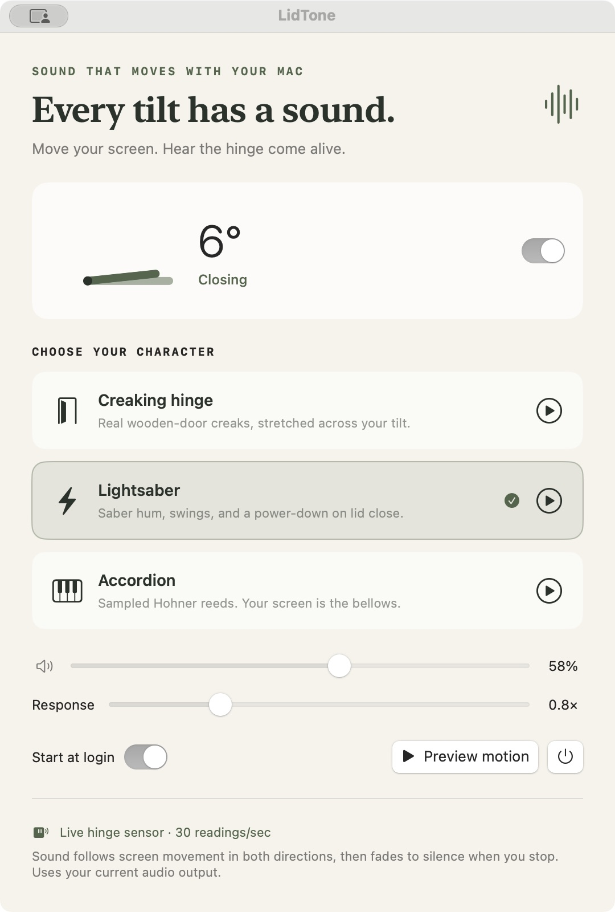

# LidTone

**Sound that moves with your MacBook screen.**

Tilt the screen forward or backward and hear recorded wooden-door creaks, a lightsaber hum and swoosh, or sampled accordion chords. Move faster and the sound responds. Hold still and it fades to silence.



## Run it

Requires **macOS 13+** and a MacBook that exposes Apple's HID hinge-angle sensor. Sensor access, live angle changes, and sound following physical screen movement were verified on an **M4 MacBook Air (Mac16,13)** with user confirmation. Compatibility depends on the sensor, not just the chip: some M1/M2 and older models do not expose it. The app reports an unavailable sensor honestly; the preview still works.

Build locally with Xcode or the Swift command line tools. No external dependencies:

```sh
git clone https://github.com/michaelMerrick6/lid-tone.git
cd lid-tone
./scripts/build-app.sh
open dist/LidTone.app
```

Choose **Creaking hinge**, **Lightsaber**, or **Accordion**, leave motion sounds enabled, and gently adjust the screen within its normal hinge range. The live angle should change. **Preview motion** demonstrates the selected sound using a simulated tilt; the displayed angle always comes from the actual sensor.

The laptop menu bar icon opens settings, previews motion, pauses sounds, or quits. Closing settings leaves the app running. Start at login is optional and uses macOS Login Items. Move the app to a stable location before enabling that option.

With full Xcode installed, build a universal app for Intel and Apple silicon:

```sh
./scripts/build-app.sh --universal
```

Outputs: `dist/LidTone.app` and `dist/LidTone-macOS.zip`. Local and beta builds are **ad-hoc signed, not Apple-notarized**. macOS may restrict downloaded builds; building locally is recommended until Developer ID distribution is available.

## Motion, not a close trigger

The app reads the **actual hinge angle at 30 Hz**, rather than waiting for a lid-close or sleep notification. Angle change produces signed angular velocity; speed sets intensity and playback rate, and a smooth envelope prevents clicks. Wood mode uses a real room-door recording. Lightsaber mode blends an independently recorded cinematic hum and moving-microphone swings. Accordion mode uses sampled Hohner reeds: C-major while opening, G-major while closing. The screen acts as the bellows.

The recordings are bundled, preloaded, and played through a continuous sample engine. Long material and crossfaded seams replace the previous rapidly modulated oscillator. Playback position survives every sensor update; no network access is needed. See [audio sources, credits, and preparation](docs/AUDIO_CREDITS.md).

The sensor may quantize readings to whole degrees. A cadence-aware hold bridges repeated readings during slow tilts, so sound does not drop out at every whole-degree step. Extremely slow movement can still be stepped; the adaptive tail can last roughly 0.6 seconds after the final movement. **Response** adjusts the strength of the motion response. It cannot add precision the hardware does not provide.

Audio plays through your current output, subject to system mute/volume. Built-in speakers offer lower latency than Bluetooth. Audio pauses after motion stops. **Lightsaber mode also powers down when you close the lid:** an independently created, recorded end effect starts at 10° or less after the screen has been opened to at least 20°. The early threshold gives the 0.884-second clip time to play before sleep. It fires once, re-arms when you open the screen, and does not run in Wood or Accordion mode. The power-button preview next to Preview motion plays the clip directly.

A real lid-close sleep notification is a fallback for a fast close that skips sensor samples. Only an actual close-triggered clip can defer the sleep acknowledgement, for at most 0.95 seconds of scheduled delay, with an independent watchdog. Idle/manual sleep with the lid open is acknowledged promptly. Audio cannot continue once macOS suspends the hardware, so complete playback at lid close is best effort. No power settings are changed.

## Under the hood

- `HingeSensor`: narrow IOHID matching for Apple vendor `0x05AC`, sensor page `0x20`, orientation usage `0x8A`; reads report 1 and validates its ID, length, and degree range.
- `MotionTracker`: signed velocity, noise threshold, short decay to silence, and safe re-baselining after wake, bad readings, or discontinuities.
- `MotionAudio`: an `AVAudioSourceNode` feeds the system mixer. A small C sample engine uses lock-free atomic controls; the render callback does not allocate memory, acquire locks, read files, or touch the UI.
- `MotionController`: one sensor queue, 30 Hz sampling, honest sensor errors, reconnect attempts, and main-thread UI updates at 10 Hz.
- Three recorded/sample-based modes, with crossfaded loops, rate smoothing, and direction-dependent accordion chords.

See [architecture](docs/architecture.md) and [testing](docs/testing.md) for implementation details and practical limits.

## Verify and develop

```sh
swift test
swift run LidTone --check
swift run LidTone --sensor-check
```

`--check` loads the five continuous recordings, renders all three modes offline, and validates the sixth power-down recording. It verifies finite, bounded, non-silent output. `--sensor-check` reads the real sensor without playing audio or modifying preferences; it intentionally fails on unsupported hardware. CI runs the unit/DSP tests and packages a universal app without requiring a physical hinge sensor.

Tests cover report parsing, startup silence, both movement directions, stopping, jitter, invalid values, sensor jumps, wake gaps, response scaling, slow quantized movement, playback position continuity, audio headroom, zero volume, fade-out, close/reopen hysteresis, mode gating, and exactly-once sleep acknowledgement with a watchdog. Passing these tests does not establish perceived sound quality or latency on every Mac; those require physical testing.

## Sensor research credit

The Apple vendor HID report format is not a documented macOS hinge-angle API. [Sam Gold's LidAngleSensor](https://github.com/samhenrigold/LidAngleSensor) made this sensor interface discoverable and demonstrated hinge-driven sound. This project implements its own Swift reader, motion mapping, interface, and sample playback engine. It does not bundle that project's code or audio; the independently sourced CC0 recordings are credited separately. Device/report compatibility may change with hardware or macOS updates.

## Privacy and removal

No accounts, network requests, telemetry, microphone access, keyboard monitoring, administrator privileges, or accessibility permission are used. The HID match is restricted to the hinge orientation sensor. Settings are stored locally in UserDefaults under `com.michaelmerrick.LidTone`.

To remove: turn off Start at login, quit, then delete the app. An earlier close-sound prototype could import clips into `~/Library/Application Support/LidTone/CustomSounds`; the motion version does not read or upload those files.

Built by Michael Merrick with AI-assisted implementation. Code: MIT. Bundled recordings: CC0; see [credits](docs/AUDIO_CREDITS.md).
